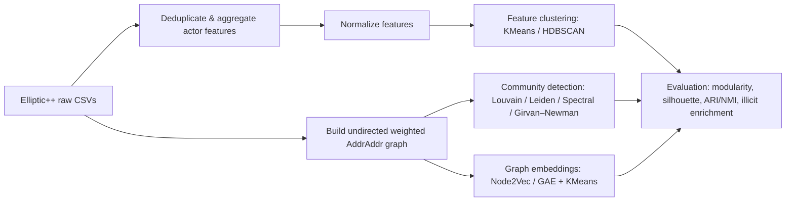

# 🕵️ Actor-Level Clustering for Detecting Money-Laundering Groups in Bitcoin (Elliptic++)

**Research paper** · HUTECH University · 2026
**Authors:** **Phan Xuân Dương** (1st author), Nguyễn Đức Vinh, Lê Nhật Tùng

📄 [Read the full paper (Vietnamese, PDF)](paper/elliptic-actor-graph-paper.pdf)

---

## 📌 Table of Contents
- [Overview](#-overview)
- [Challenges](#-challenges)
- [Pipeline](#-pipeline)
- [Methods Compared](#-methods-compared)
- [Key Results](#-key-results)
- [Project Structure](#-project-structure)
- [How to Run](#-how-to-run)
- [Tech Stack](#-tech-stack)

---

## 📖 Overview
Bitcoin is **pseudo-anonymous**: transactions are public, but the owners of wallet addresses are not. This makes it hard to find groups of addresses that work together in money laundering, ransomware or fraud.

This project studies **community detection and clustering at the actor (wallet-address) level** on the **Elliptic++** dataset. It combines behavioral features with the address-to-address interaction graph. The labels (illicit / licit) are used **only for external evaluation**, never for training, so the whole setting is **unsupervised**.

| Dataset fact | Value |
|---|---|
| Actors (wallet addresses) | **822,942** |
| AddrAddr edges | **2,868,964** |
| Illicit / Licit / Unknown | 1.73% / 30.51% / 67.76% |


## 🧗 Challenges
1. **Scale:** 820K+ nodes and ~2.9M edges. Methods like GAE (N×N adjacency) and Girvan–Newman are too expensive for the full graph.
2. **Extreme label scarcity & imbalance:** only 1.73% of actors are illicit, and most are unlabeled.
3. **No timestamps on the AddrAddr graph**, so temporal subgraphs cannot be built directly.
4. **No ready-made "user entity" graph:** connected components do not represent real entities (one giant component holds 822,935 addresses).

## 🏗 Pipeline

- Memory-aware design for a laptop with **8 GB RAM / 2 CPU cores**: chunked CSV reads, and the full graph is never built in NetworkX.

## 🔬 Methods Compared
Six unsupervised methods were run on the same preprocessing pipeline, graph and evaluation protocol:

| Family | Methods |
|---|---|
| Modularity-based community detection | **Louvain**, **Leiden** |
| Spectral / divisive | Spectral clustering, Girvan–Newman |
| Graph representation learning | **Node2Vec + KMeans**, **GAE + KMeans** |
| Feature-only baselines | KMeans, HDBSCAN |

## 📊 Key Results


- **Louvain / Leiden** reach very high modularity (**0.9247 / 0.9248**), but the partition is extremely fragmented: ~96% of clusters contain a single address.
- **Node2Vec + KMeans** and **GAE + KMeans** reach silhouettes of **0.630** and **0.751**, but they put 89.4–93.5% of addresses into one cluster.
- **ARI against known labels is ≈ 0 for every method** (−0.0153 to 0.0006).
- **Weighted Leiden on the full actor graph** (resolution 1.0) finds **887 communities** (modularity 0.9212). One community holds **1,142 illicit actors among 1,730 labeled ones (12.28× illicit enrichment)**. This was checked with permutation nulls and multiple seeds.

💡 **Takeaway:** internal metrics (modularity, silhouette) alone **are not enough** to say that clusters mean anything for fraud detection. The paper reports these limits openly and proposes size-controlled baselines and full-graph extensions.


## 📁 Project Structure
```text
config/experiment.json       Reproducible settings and resource limits
notebooks/                   01 EDA → 02 graph communities → 03 CC-MVAD → 04 paper results → 05 model visualization
src/data/                    Data audit and actor feature API
src/graph/                   Graph and community API
src/models/                  Clustering and multi-view API
models/                      Saved preprocessing bundle, KMeans (k = 4/8/12) and HDBSCAN models
results/                     Tables, memberships, enrichment, robustness summaries
figures/                     Generated visualizations
reports/                     Research report and paper notes
paper/                       Final paper (PDF)
```

## 🚀 How to Run
```bash
pip install -r requirements.txt
python -m src.data_audit      --data-dir data
python -m src.run_experiments --data-dir data --output-dir results --sample-size 20000
python -m src.run_community   --data-dir data --output-dir results --resolution 1.0
```
Download the Elliptic++ dataset into `data/` first (it is not included because of its size).

Load a fitted model without refitting:
```python
from pathlib import Path
from src.artifacts import load_artifact
bundle = load_artifact(Path("models/kmeans_8.joblib"))
labels = bundle["model"].predict(embedding)
```

## 🛠 Tech Stack
      
